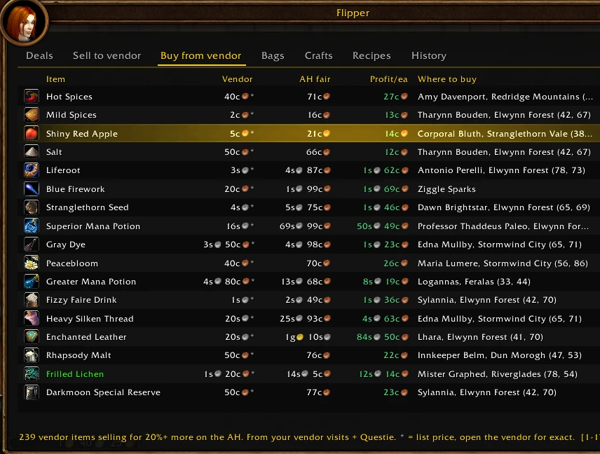

# Flipper

A World of Warcraft: Forever addon that shows where the gold is: underpriced auctions, vendor flips, what to do with each item in your bags, and which crafts and recipes pay.

Flipper only reads and advises. It never buys or posts; rows hand you over to Auctionator, where you confirm the purchase or the price yourself.

## What it does

| Tab | Shows |
|---|---|
| **Deals** | Items listed at 70% or less of their usual price, with the profit from reselling at the average. |
| **Sell to vendor** | Auctions cheaper than what a vendor pays for the item. |
| **Buy from vendor** | Vendor goods that sell for 20%+ more on the AH, and where to buy them. |
| **Bags** | The best use of each item you carry: auction, vendor, or craft. |
| **Crafts** | Profit per craft for the recipes you know. |
| **Recipes** | Recipes for sale that you don't know and that would pay for themselves. |
| **History** | Price history for every item, plus estimated sales from full scans. |

Every item tooltip says what to do with it: keep it for your professions, craft it, disenchant it, auction it or vendor it, plus the recipes it goes into and what those lead to. See [Tooltips](docs/tooltips.md).

## Install these first

Flipper reads its data from other addons. **Install them before Flipper**, or most of it will be empty.

| Addon | | Without it |
|---|---|---|
| [Auctionator](https://www.curseforge.com/wow/addons/auctionator) | **Required** | No prices: no Deals, no flips, no profits, no tooltip verdicts, no AH tab. |
| [Questie](https://www.curseforge.com/wow/addons/questie) | Strongly recommended | Buy from vendor only knows vendors you've opened yourself; no vendor locations in tooltips. |
| [Journalator](https://www.curseforge.com/wow/addons/journalator) | Recommended | No record of your own sales in tooltips. |

Use the versions made for WoW Forever. TSM works as a price source instead of Auctionator, but the AH tab and the shared scans need Auctionator. Details: [Install guide](docs/install.md#install-these-first).

## Install

1. Install the addons above and log in once, then run an Auctionator scan at the auction house.
2. Download `Flipper-<version>.zip` from [Releases](https://github.com/glholland/Flipper/releases).
3. Unzip it into `World of Warcraft/_forever_/Interface/AddOns`, so that `AddOns/Flipper/Flipper.toc` exists.
4. Restart the game. A `/reload` does not pick up a new addon.

Full instructions, updating, and installing from source: [Install guide](docs/install.md).

## First steps

1. Make sure Auctionator has scanned the AH recently (Flipper's Full scan does this too).
2. Open each of your profession windows once. Flipper reads your recipes from them.
3. Click the **Flipper** tab at the bottom of the auction house, the minimap button, or type `/flip` anywhere. Right-click the minimap button for every setting.
4. Press **Full scan** on most AH visits. Two full scans between 15 minutes and 12 hours apart start filling the Sold/day columns. **Quick scan** is the fast, unlimited option for the Sell to vendor list.

## Documentation

- [Install guide](docs/install.md): finding the AddOns folder, updating, installing from source.
- [User guide](docs/guide.md): every tab, scanning, the minimap button, settings and slash commands.
- [Tooltips](docs/tooltips.md): every tooltip line explained.
- [Sales estimates](docs/sales-estimates.md): how Sold/day is worked out and how far to trust it.
- [Data](docs/data.md): where prices, recipes and vendor information come from.
- [Troubleshooting](docs/troubleshooting.md)
- [Development](docs/development.md): layout, tests, CI and releases.

Third-party notices are in [NOTICE](NOTICE).
