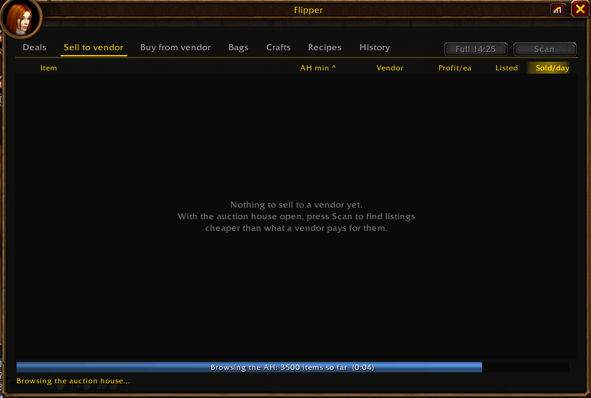
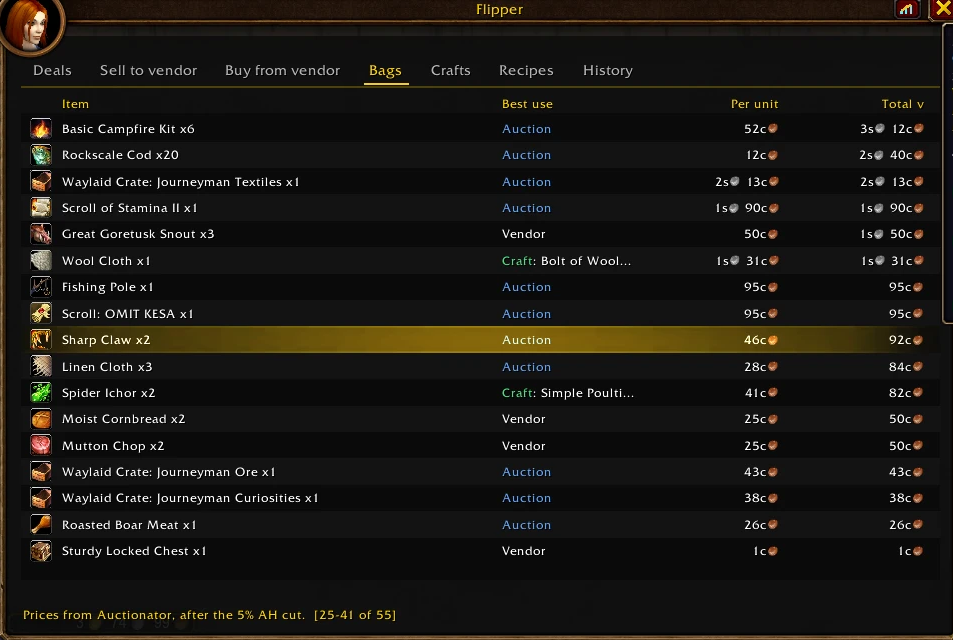
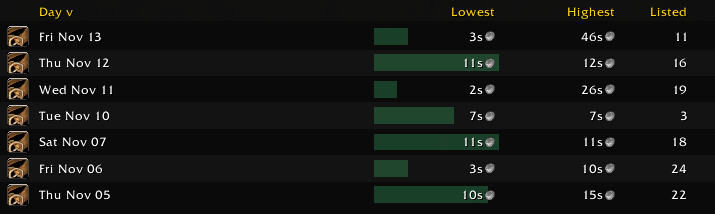

# User guide

At the auction house, Flipper is a tab along the bottom next to Auctionator's. Anywhere else, `/flip` opens it as a movable, resizable window.

In every list:

- Click a column header to sort; click again to reverse.
- Right-click a row to open that item's price and sales history.
- Hover a row for the item tooltip and what a click does.

## Deals

Items whose cheapest listing is 70% or less of their usual price (Auctionator's 21-day average). Only items seen today or yesterday with at least 5 days of price history are listed.

- **Now / Usual:** cheapest listing and the average.
- **Profit/ea:** the average after the 5% AH cut, minus the price now.
- **Days seen, Sold/day:** how much evidence there is that the item actually trades.

Click a row to search for it in Auctionator. The list is only as fresh as your last Auctionator scan.

## Sell to vendor

Auctions priced below what any vendor pays. Buy, walk to a vendor, sell.



- **Scan** browses the AH once and fills this list. No cooldown, nothing saved.
- **Full** downloads every listing for the [sales estimates](sales-estimates.md). The button shows the time left on its 15-minute cooldown.
- `/flip minprofit 50` hides flips under 50 copper per item (default 10).

"Listed" is the item's total on the AH, not how many are below vendor price.

## Buy from vendor

Things vendors sell that go for at least 20% more on the AH after the cut. An item needs 3 days of price history to appear, so a single hopeful listing doesn't count.

- **Vendor:** the vendor's price. A `*` means list price from game data; open the vendor once and Flipper records the exact price, including reputation discounts.
- **(limited):** the vendor has limited stock.
- **Where to buy:** the nearest known seller. Click the row for a map pin; Shift-click to check the AH in Auctionator.

Flipper remembers every vendor you open. With Questie installed it also knows vendors you haven't visited.

## Bags

What each item in your bags is best used for.



- **Auction / Vendor:** whichever pays more per unit, after the AH cut.
- **Craft:** a recipe you know turns the item into something worth more.
- **Disenchant:** for enchanters, the materials are worth more on the AH than the item.
- Soulbound items are never advised for the AH.

Click a row to open Auctionator's Selling tab with that item picked.

## Crafts

Profit per craft for every recipe your character knows.

- **Cost:** reagents at the cheaper of AH and vendor price.
- **Value:** what the output sells for after the cut, or the vendor price if that's higher (marked "(vendor)").

Open a profession window once for its recipes to appear.

## Recipes

Recipes on the AH that you don't know yet and that would make money.

- **Vendor:** the vendor price if a vendor sells the recipe, otherwise "Drop".
- **Pays back:** crafts needed to earn back the recipe's price.
- **Skill:** green means you can learn it now, red that you need more skill, grey that it's another profession.

The button at the top right cycles the filter: your professions, one profession, or every profession.

## History

Every item Auctionator has priced in the last 14 days. Type in the search box to filter; the list updates when you stop typing or press Enter.

Click an item for its day-by-day view: lowest and highest price, quantity listed, and estimated sold, expired and cancelled counts for days with full scans.



Shift-clicking an item link anywhere while this tab is open jumps to that item.

## Tooltip

Every item tooltip gets one Flipper line:

- **Keep for Tailoring (3 known, 6 recipes):** your professions use it.
- **Craft Silk Bag: 3s each:** a recipe you know beats selling it.
- **Disenchant it:** you're an enchanter and the materials beat selling the item.
- **Auction it / Vendor it:** nothing you craft needs it; this is the better sale.

For gear, enchanters also see what it disenchants into and the enchants those materials are used in, known enchants first:

```
Flipper Vendor it
  Disenchants into Small Glowing Shard
  Enchanting: Enchant 2H Weapon - Minor Impact (1 Small Glowing Shard)
  Enchanting 115: Enchant Shield - Lesser Protection (1 Small Glowing Shard)
```

Other characters see these lines with Shift held. Disenchant results follow the original-era tables, with Disenchantry's estimates for Forever's own rare items.

Up to three recipes from your own professions follow. When a recipe turns the item into something other recipes use (ore into bars, cloth into bolts, leather into cured leather), the next step is listed under it, so you can see what the item is ultimately for:

```
Flipper Keep for Tailoring (1 known, 4 recipes)
  Tailoring: Bolt of Linen Cloth x2 (known)  -> 23 recipes
      Tailoring 50: Linen Bag (3)
      Tailoring 70: Reinforced Linen Cape (2)
```

The next-step lines show your own professions; with Shift held they include every profession. Hold Shift before hovering to also see the price after the cut, where a vendor sells it, sales estimates and other professions' recipes.

Recipe lines are green if you know the recipe or have the skill for it, red if your skill is too low, and grey for other professions. Recipes learned from trainers show no skill number.

`/flip tooltip` turns the tooltip lines off and on.

## Commands

| Command | Does |
|---|---|
| `/flip` | Open or close the window |
| `/flip deals`, `flips`, `vendor`, `bags`, `crafts`, `recipes`, `history` | Open that tab |
| `/flip scan` | Scan for auctions below vendor price |
| `/flip market` | Run a full scan |
| `/flip history <item link or ID>` | Open one item's history |
| `/flip recipes all` | Show recipes for every profession |
| `/flip minprofit <copper>` | Smallest flip worth listing |
| `/flip tooltip` | Toggle tooltip lines |
| `/flip verify` | Compare the shipped recipe data with your known recipes |
| `/flip reset` | Reset the window's size and position |
